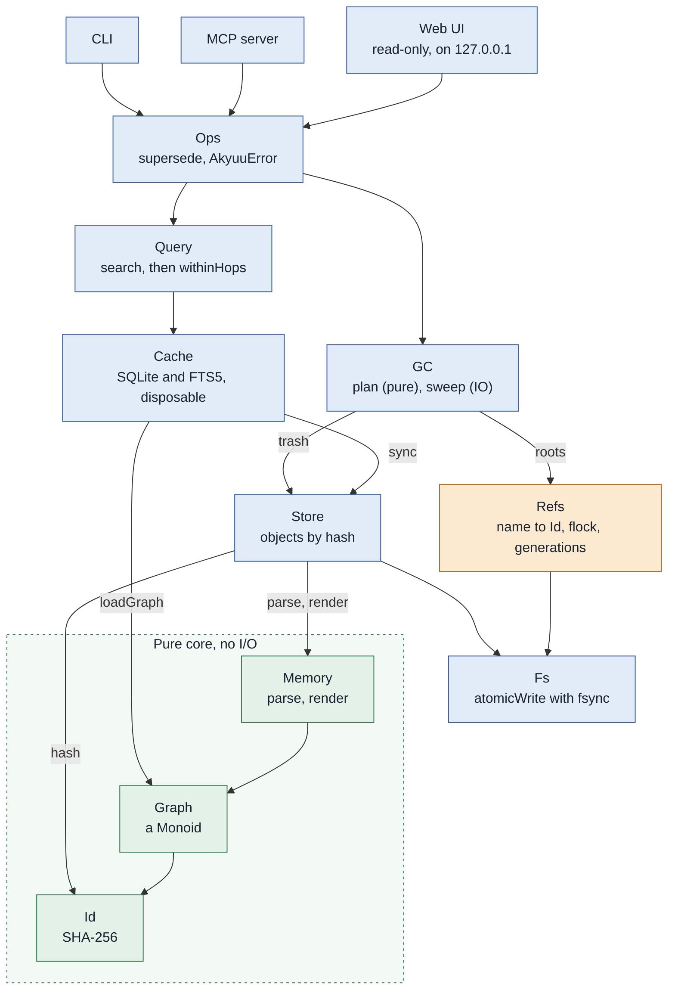

# Akyuu

Akyuu is a persistent store for AI agents modelled on Nix. It retains a single
store of truth as plaintext, and builds a DAG on top of that. The DAG is
queryable and allows chains of memories and concepts to be followed.

## Usage

Akyuu can be interfaced with through a command-line tool `akyuu` or the MCP (Model Context Protocol) server.

## Design

Akyuu consists of 4 main "parts":

- The store: A content-addressable store. Immutable plaintext on disk.
- The graph: An acyclic graph derived from the store, representing relations between memories.
- Refs: The mutable layer. Akin to Nix profiles or Git refs. Old memories are "superseded" by new ones.
- GC: Garbage collector prunes superseded memories.

In pseudo-Haskell:

```hs
Store  :: Id -> Memory          -- immutable, content-addressed, plaintext on disk
Refs   :: Name -> Id            -- the only mutable layer (like git refs / Nix profiles)
Graph  = foldMap edges Store   -- derived, so the cache is disposable
GC     = sweep (Store \ reachable Roots)
```

## Architecture

Each layer uses only the layers below it. The pure core (green) does no I/O. Refs
(amber) is the only layer that changes a value in place. The web UI only reads.



On disk, `store/` and `refs/` are the sources of truth. `cache.sqlite` is derived from
them, so it can be deleted at any time. GC moves swept objects to `trash/` and does
not delete them at once.

## Data Format

Data addressed by Akyuu must follow this format:

```text
kind: <kind>
created: <timestamp>
agent: <agent>
supersedes: sha256-<...>
about: sha256-<...>

<body>
```
