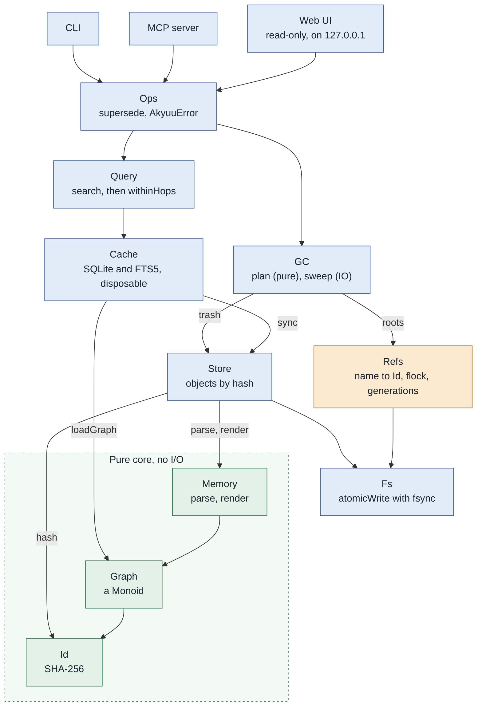

# Akyuu

[](https://github.com/lillycham/akyuu/actions/workflows/ci.yml)
[](LICENSE)

Akyuu is a persistent memory store for AI agents, modelled on Nix. A memory is
an immutable plain-text file, named by the hash of its text. A small mutable
layer of named refs says which memory is current, and a graph of links
between memories is derived from the files. An agent reads and writes it
through a command line or an MCP server, so Claude Code, Codex and
other MCP clients can share one memory.

**Status: 0.2.0.0, pre-1.0.** I daily drive Akyuu with all my agents, and
have found it to work well for holding general information and task-specific
information. I test a lot and run the latest main build in my config, so I find
issues quite quickly. With that said, Akyuu should be treated as beta software,
and features and interfaces are likely to change.

## Features

- **Remembering facts** - A ref like `me/projects/garden` names the latest memory. When it needs to be updated, an agent "supersedes" it, and the old one will eventually be *garbage-collected*. History is retained until this happens.
- **Noting down events** - A log (`append`, `note`) keeps episodic memory in order.
- **Recall** - Fuzzy search allows some leeway in searching for memories, and you can optionally use an embedding model to get semantic searching.
- **Self-tidying** - `check` finds forks, stale links, duplicates, and an agent can use that to clean up and consolidate memories.

<picture>
  <source media="(prefers-color-scheme: dark)" srcset="docs/images/webui-wiki-dark.png">
  
</picture>

A web UI (shown above, `akyuu serve`) is included. This allows the memory bank
to be explored through a wiki interface, as well as visualising the graph,
providing search, and displaying information about the health and function of
the akyuu store.

## Quick start & installation

To let an agent do the install, point it at
[docs/agent-install.md](docs/agent-install.md) from a release tag. It asks you
before it changes your files.

The intended way to install Akyuu is through Nix with home-manager.
The home-manager module configures the root, GC, backups and versioning, and
sets up `launchd` or `systemd` services to run the above automatically.
The home-manager module of the flake installs the binary, sets `AKYUU_ROOT`,

See [docs/install.md](docs/install.md) for both, the daily jobs, `akyuu-backup`
and `akyuu-version`.


## Trust and safety

- **One user.** We do not currently implement access controls. Any agent
  connected to the MCP can write to and read from the store. Only give Akyuu
  to agents you trust to see your memories.
- **Local.** The MCP server speaks on stdio, and the webview only listens on
  localhost.
- **Commands from settings.** `AKYUU_EMBED_COMMAND` is run with `sh -c`. It
  comes from the environment or from `~/.config/akyuu/embed.env`: protect that
  file like a script.
- **Forgetting.** Memories that have been superseded will be garbage collected,
  and eventually deleted completely. You can make backups, and `akyuu-version`
  serves to bring memories into Git for versioning and sync.
- **Secrets.** Do not store passwords or keys in memories, as they are
  plaintext and readable by anyone on your device.

## Documents

| Topic | Document |
|---|---|
| The format on disk, and what is stable | [docs/format.md](docs/format.md) |
| Install, the home-manager module, backup, versioning | [docs/install.md](docs/install.md) |
| An install guide for an agent to follow | [docs/agent-install.md](docs/agent-install.md) |
| Search by meaning, models, evaluation | [docs/embeddings.md](docs/embeddings.md) |
| Logs and forgetting | [docs/episodes.md](docs/episodes.md) |
| Finding duplicates, forks, stale links | [docs/check.md](docs/check.md), [docs/judgement.md](docs/judgement.md) |
| Tiers, places, notes, hooks for agents | [docs/hooks.md](docs/hooks.md) |
| The web view | [docs/wiki-view.md](docs/wiki-view.md), [docs/webui-tabs.md](docs/webui-tabs.md) |
| Security, contributing | [SECURITY.md](SECURITY.md), [CONTRIBUTING.md](CONTRIBUTING.md) |

## Usage

```sh
export AKYUU_ROOT=~/.local/share/akyuu   # or pass --root DIR

akyuu add --kind fact --agent me --body "Nix for every tool."   # prints the id
akyuu add --ref me/tools --kind fact --agent me --body "..."    # the same, under a new ref
akyuu search nix                    # text search, with the memories near each hit
akyuu get 08d4                      # the start of an id is enough
akyuu supersede me/notes --kind fact --agent me --body "..."
akyuu ref list                      # the name and the id of each ref
akyuu gc --dry-run --grace 30m      # also --keep-generations N, --trash-ttl 7d
akyuu pin 08d4                      # GC keeps a pinned memory
akyuu pins                          # the id of each pin (akyuu unpin ID removes one)
akyuu init                          # start a store: a policy for agents and a manifest of tiers
akyuu context                       # the memories every session needs, in one call (the tier "always")
akyuu context --page 1              # the same, in pages that fit a Claude Code hook (docs/hooks.md)
akyuu amend me/notes --from tea --to coffee   # change one passage; the ref moves to a new memory (also --append TEXT)
akyuu embed                         # vectors for search by meaning (docs/embeddings.md)
akyuu search-eval                   # run a set of searches in each mode
akyuu note "a small thing"          # an episode in the log that the manifest names for this directory
akyuu compare 08d4 1c9b             # what each of two memories says that the other lacks
akyuu review 08d4 1c9b --agent me   # both are true and different: check leaves the pair out
akyuu status                        # the setup in a few lines: counts, manifest, policy, vectors, git
akyuu check                         # stale links, forks, duplicates, memories nothing keeps
akyuu append me/episodes --kind episode --agent me --body "..."   # a log: each episode points at the one before
akyuu log me/episodes               # the episodes, newest first (see docs/episodes.md)
akyuu log me/episodes --since 7d    # only the last week
akyuu serve                         # the read-only web UI on 127.0.0.1:7420
akyuu seed --demo --root /tmp/demo  # a demo store, for the web UI
```

## Checks

`nix flake check` runs the unit tests and tests of `akyuu-backup` and `akyuu-version` in the Nix
sandbox. For day to day work, `nix develop -c cabal test`.

## Design

Akyuu has four main parts, in pseudo-Haskell:

```hs
Store  :: Id -> Memory          -- immutable, content-addressed, plaintext on disk
Refs   :: Name -> Id            -- the only mutable layer (like git refs / Nix profiles)
Graph  = foldMap edges Store   -- derived, so the cache is disposable
GC     = sweep (Store \ reachable Roots)
```

## Architecture

Each layer uses only the layers below it. The pure core (green) does no I/O. Refs
(amber) is the only layer that changes a value in place. The web UI only reads.



On disk, `store/` and `refs/` are the sources of truth. `cache.sqlite` is derived from
them, so it can be deleted at any time. GC moves swept objects to `trash/` and does
not delete them at once.

## Licence

Akyuu is under the MIT licence ([LICENSE](LICENSE)).

The web view contains two fonts under the SIL Open Font License 1.1: Shippori
Mincho B1 and Spline Sans Mono. Their licences are in [web/fonts/](web/fonts/).
