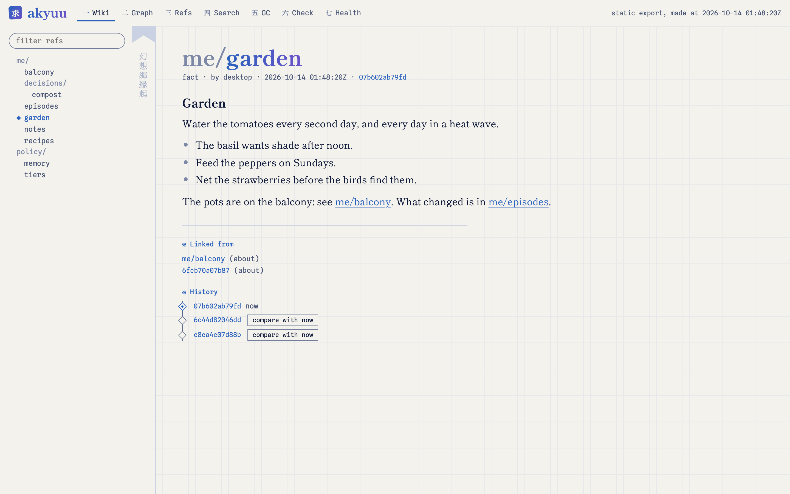
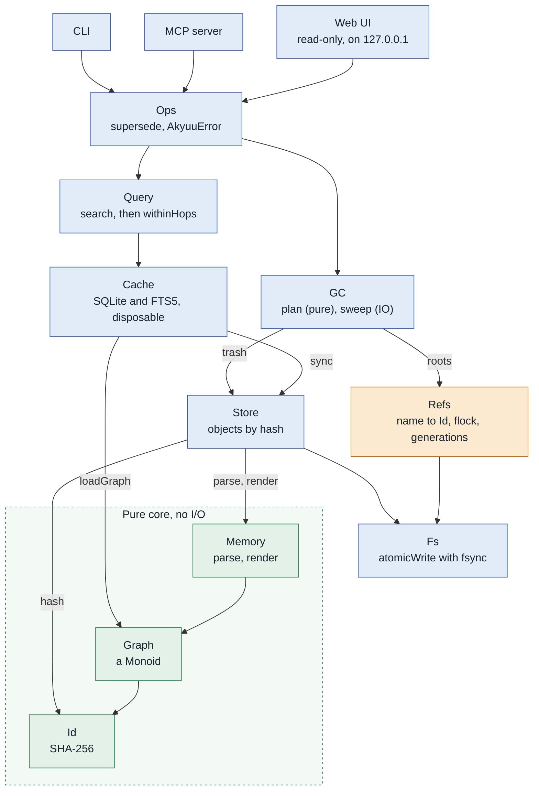

# Akyuu

[](https://github.com/lillycham/akyuu/actions/workflows/ci.yml)
[](LICENSE)

Akyuu is a persistent memory store for AI agents, modelled on Nix. A memory is
an immutable plain-text file, named by the hash of its text. A small mutable
layer of named refs says which memory is current, and a graph of links
between memories is derived from the files. An agent reads and writes it
through a command line or an MCP server, so Claude Code, Claude Desktop and
other MCP clients can share one memory.

**Status: 0.2.0.0, pre-1.0.** It is in daily use by its author. Commands and
MCP tools can still change. The store format is in [docs/format.md](docs/format.md),
the changes are in [CHANGELOG.md](CHANGELOG.md), and open work is in
[ROADMAP.md](ROADMAP.md). It is written in Haskell and built with Nix.

What it is for:

- **Facts that change.** A ref such as `me/projects/garden` names the
  current text. To change it, an agent adds a new memory that supersedes the
  old one. Nothing is edited, so the history is kept until GC collects it.
- **Things that happened.** A log (`append`, `note`) keeps episodes in order.
- **Finding things.** Text search that forgives typing mistakes, and optional
  search by meaning with an embedding model that you choose.
- **Keeping it tidy.** `check` finds duplicates, forks and stale links, and an
  agent decides what to do.

<picture>
  <source media="(prefers-color-scheme: dark)" srcset="docs/images/webui-wiki-dark.png">
  
</picture>

The read-only web view (`akyuu serve`) shows each ref as a wiki page, and the
store as a graph, with search, GC, check and health tabs.

## Quick start

```sh
nix run github:lillycham/akyuu -- --help      # or: nix profile install github:lillycham/akyuu

export AKYUU_ROOT=~/.local/share/akyuu
akyuu init                                    # makes the root, a policy for agents and a manifest
akyuu add --kind fact --agent me --body "Nix for every tool."
akyuu search nix
akyuu serve                                   # a read-only web view on http://127.0.0.1:7420
```

Give an agent the store. For Claude Code:

```sh
claude mcp add --scope user akyuu -- akyuu --root ~/.local/share/akyuu mcp
```

For Claude Desktop, add this to `claude_desktop_config.json`:

```json
{ "mcpServers": { "akyuu": { "command": "akyuu", "args": ["--root", "/Users/you/.local/share/akyuu", "mcp"] } } }
```

Use the full path of `akyuu` as the command if the app does not have it in its
`PATH`. The MCP server tells the agent to read the policy of the store first:
`akyuu init` writes a short one under `policy/memory`. Change it to fit you, or
name another ref with `--policy-ref` (or `AKYUU_POLICY_REF`).

## Trust and safety

- **One user.** There is no access control. A client of the MCP server can
  add, supersede and point refs, so give it only to agents that you trust with
  the memories.
- **Local.** The MCP server speaks on stdio. The web view is read-only and
  listens on `127.0.0.1` only, and it checks the `Host` header.
- **Commands from settings.** `AKYUU_EMBED_COMMAND` is run with `sh -c`. It
  comes from the environment or from `~/.config/akyuu/embed.env`: protect that
  file like a script.
- **Forgetting.** To forget a memory, supersede it with a text that leaves it
  out. GC then deletes the old text after the grace period and the ref
  generations. If you keep the store in git (`akyuu-version`), the old text
  stays in the history until you rewrite it.
- **Secrets.** Do not store passwords or keys in memories.

## Documents

| Topic | Document |
|---|---|
| The format on disk, and what is stable | [docs/format.md](docs/format.md) |
| Search by meaning, models, evaluation | [docs/embeddings.md](docs/embeddings.md) |
| Logs and forgetting | [docs/episodes.md](docs/episodes.md) |
| Finding duplicates, forks, stale links | [docs/check.md](docs/check.md), [docs/judgement.md](docs/judgement.md) |
| Tiers, places, notes, hooks for agents | [docs/hooks.md](docs/hooks.md) |
| The web view | [docs/wiki-view.md](docs/wiki-view.md), [docs/webui-tabs.md](docs/webui-tabs.md) |
| Security, contributing | [SECURITY.md](SECURITY.md), [CONTRIBUTING.md](CONTRIBUTING.md) |

## Usage

```sh
export AKYUU_ROOT=~/.local/share/akyuu   # or pass --root DIR

akyuu add --kind fact --agent me --body "Nix for every tool."   # prints the id
akyuu add --ref me/tools --kind fact --agent me --body "..."    # the same, under a new ref
akyuu search nix                    # text search, with the memories near each hit
akyuu get 08d4                      # the start of an id is enough
akyuu supersede me/notes --kind fact --agent me --body "..."
akyuu ref list                      # the name and the id of each ref
akyuu gc --dry-run --grace 30m      # also --keep-generations N, --trash-ttl 7d
akyuu pin 08d4                      # GC keeps a pinned memory
akyuu pins                          # the id of each pin (akyuu unpin ID removes one)
akyuu init                          # start a store: a policy for agents and a manifest of tiers
akyuu context                       # the memories every session needs, in one call (the tier "always")
akyuu context --page 1              # the same, in pages that fit a Claude Code hook (docs/hooks.md)
akyuu amend me/notes --from tea --to coffee   # change one passage; the ref moves to a new memory (also --append TEXT)
akyuu embed                         # vectors for search by meaning (docs/embeddings.md)
akyuu search-eval                   # run a set of searches in each mode
akyuu note "a small thing"          # an episode in the log that the manifest names for this directory
akyuu compare 08d4 1c9b             # what each of two memories says that the other lacks
akyuu review 08d4 1c9b --agent me   # both are true and different: check leaves the pair out
akyuu status                        # the setup in a few lines: counts, manifest, policy, vectors, git
akyuu check                         # stale links, forks, duplicates, memories nothing keeps
akyuu append me/episodes --kind episode --agent me --body "..."   # a log: each episode points at the one before
akyuu log me/episodes               # the episodes, newest first (see docs/episodes.md)
akyuu log me/episodes --since 7d    # only the last week
akyuu serve                         # the read-only web UI on 127.0.0.1:7420
akyuu seed --demo --root /tmp/demo  # a demo store, for the web UI
```

## Install

With Nix and home-manager, take the flake as an input and import its module:

```nix
inputs.akyuu.url = "github:lillycham/akyuu";

# in the home-manager configuration
imports = [ inputs.akyuu.homeModules.default ];
programs.akyuu = {
  enable = true;        # the binary, AKYUU_ROOT, and the store directory
  gc.enable = true;     # `akyuu gc` once a day (03:30)
  backup.enable = true; # `akyuu-backup` once a day (04:00)
  # gc.keepGenerations = 5;  # older values of each ref that GC keeps
  # gc.gracePeriod = "1h";   # GC keeps a memory younger than this
  # gc.trashTTL = "7d";      # GC deletes trash files older than this
  # root = "~/.local/share/akyuu";
  # serve.enable = true;  # the web UI as a user service, on port 7420
};
```

The three `gc` options are passed to `akyuu gc` as `--keep-generations`, `--grace` and `--trash-ttl`.
A time is a number and a unit (`s`, `m`, `h` or `d`). The values above are the defaults.

Without home-manager: `nix profile install .#akyuu`, or `nix run .#akyuu -- --help`.
The daily jobs are launchd agents on macOS, with their logs in `~/Library/Logs`.
On Linux they are systemd user timers (`systemctl --user list-timers 'akyuu-*'`,
logs with `journalctl --user -u akyuu-gc`). A timer that was missed, because the
machine was off, runs at the next start.

Then give an agent the store as in [Quick start](#quick-start).

## Backup

`akyuu-backup --root DIR --dest DIR [--keep N]` makes a snapshot of `store`,
`trash`, `tombstones`, `pins`, `reviewed` and `refs`. It does not copy the cache, because
`akyuu reindex` makes that again. A file that did not change is a hard link to
the one in the last snapshot, so a snapshot of an unchanged store costs almost
nothing. The objects are copied first and the refs last, so every ref in a
snapshot points to an object in it.

To restore, copy the directories of a snapshot into an empty root and run
`akyuu --root ROOT reindex`. Then `akyuu --root ROOT verify` checks the store.

## Versioning

`akyuu-version [--root DIR] [--message TEXT]` keeps the memories in a git
repository in the root of the store. It holds `store`, `refs`, `pins`,
`reviewed` and `tombstones`. The cache, the locks and `trash` are not in it
(a `.gitignore` is made). One run makes one commit of what changed, and none if
nothing did. The message says what changed: `3 memories added, 1 removed, 2
refs changed`.

The history is the history of the memory. A memory that GC removed is still in
git, and a ref that moved can be put back. It is also a copy that can go to a
remote: add one with `git -C ROOT remote add …`. The script pushes only with
`--push` (`programs.akyuu.versioning.push = true`), to the first remote, and a
failed push is a warning. Keep that remote private.

With the home-manager module: `programs.akyuu.versioning.enable = true;` runs it
daily at 04:15, after GC (03:30) and the backup (04:00).

## Checks

`nix flake check` runs the unit tests and tests of `akyuu-backup` and `akyuu-version` in the Nix
sandbox. For day to day work, `nix develop -c cabal test`.

## Design

Akyuu has four parts, in pseudo-Haskell:

```hs
Store  :: Id -> Memory          -- immutable, content-addressed, plaintext on disk
Refs   :: Name -> Id            -- the only mutable layer (like git refs / Nix profiles)
Graph  = foldMap edges Store   -- derived, so the cache is disposable
GC     = sweep (Store \ reachable Roots)
```

## Architecture

Each layer uses only the layers below it. The pure core (green) does no I/O. Refs
(amber) is the only layer that changes a value in place. The web UI only reads.



On disk, `store/` and `refs/` are the sources of truth. `cache.sqlite` is derived from
them, so it can be deleted at any time. GC moves swept objects to `trash/` and does
not delete them at once.

## Licence

Akyuu is under the MIT licence ([LICENSE](LICENSE)).

The web view contains two fonts under the SIL Open Font License 1.1: Shippori
Mincho B1 and Spline Sans Mono. Their licences are in [web/fonts/](web/fonts/).
