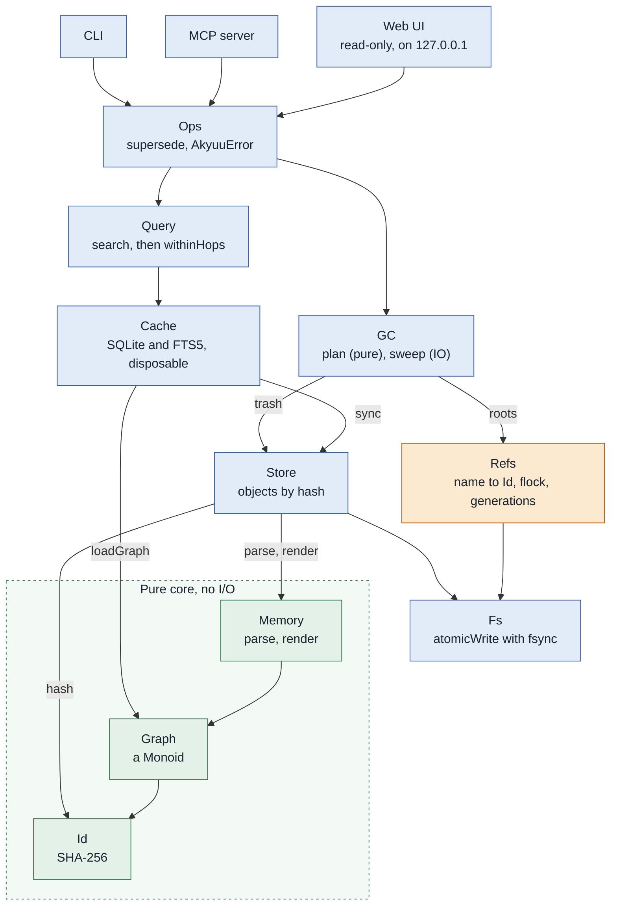

# Akyuu

Akyuu is a persistent store for AI agents modelled on Nix. It retains a single
store of truth as plaintext, and builds a DAG on top of that. The DAG is
queryable and allows chains of memories and concepts to be followed.

## Usage

Akyuu can be interfaced with through a command-line tool `akyuu` or the MCP (Model Context Protocol) server.

```sh
export AKYUU_ROOT=~/.local/share/akyuu   # or pass --root DIR
mkdir -p "$AKYUU_ROOT"                   # the root must exist

akyuu add --kind fact --agent me --body "Nix for every tool."   # prints the id
akyuu search nix                    # text search, with the memories near each hit
akyuu get 08d4                      # the start of an id is enough
akyuu supersede me/notes --kind fact --agent me --body "..."
akyuu ref list                      # the name and the id of each ref
akyuu gc --dry-run --grace 30m      # also --keep-generations N, --trash-ttl 7d
akyuu pin 08d4                      # GC keeps a pinned memory
akyuu pins                          # the id of each pin (akyuu unpin ID removes one)
akyuu context                       # the memories every session needs, in one call (the tier "always")
akyuu amend me/notes --from tea --to coffee   # change one passage; the ref moves to a new memory (also --append TEXT)
akyuu embed                         # vectors for search by meaning (docs/embeddings.md)
akyuu search-eval                   # run a set of searches in each mode
akyuu note "a small thing"          # an episode in the log that the manifest names for this directory
akyuu compare 08d4 1c9b             # what each of two memories says that the other lacks
akyuu review 08d4 1c9b --agent me   # both are true and different: check leaves the pair out
akyuu check                         # stale links, forks, duplicates, memories nothing keeps
akyuu append me/episodes --kind episode --agent me --body "..."   # a log: each episode points at the one before
akyuu log me/episodes               # the episodes, newest first (see docs/episodes.md)
akyuu serve                         # the read-only web UI on 127.0.0.1:7420
akyuu seed --demo --root /tmp/demo  # a demo store, for the web UI
```

## Install

With Nix and home-manager, take the flake as an input and import its module:

```nix
inputs.akyuu.url = "git+https://github.com/lillycham/akyuu";   # private: use git

# in the home-manager configuration
imports = [ inputs.akyuu.homeModules.default ];
programs.akyuu = {
  enable = true;        # the binary, AKYUU_ROOT, and the store directory
  gc.enable = true;     # `akyuu gc` once a day, under launchd (03:30)
  backup.enable = true; # `akyuu-backup` once a day, under launchd (04:00)
  # gc.keepGenerations = 5;  # older values of each ref that GC keeps
  # gc.gracePeriod = "1h";   # GC keeps a memory younger than this
  # gc.trashTTL = "7d";      # GC deletes trash files older than this
  # root = "~/.local/share/akyuu";
  # serve.enable = true;  # the web UI as a user service, on port 7420
};
```

The three `gc` options are passed to `akyuu gc` as `--keep-generations`, `--grace` and `--trash-ttl`.
A time is a number and a unit (`s`, `m`, `h` or `d`). The values above are the defaults.

Without home-manager: `nix profile install .#akyuu`, or `nix run .#akyuu -- --help`.
The module writes launchd agents on macOS only. On Linux it installs the
package and sets `AKYUU_ROOT`.

To give an agent the store, run the MCP server over stdio. For Claude Code:

```sh
claude mcp add --scope user akyuu -- akyuu --root ~/.local/share/akyuu mcp
```

## Backup

`akyuu-backup --root DIR --dest DIR [--keep N]` makes a snapshot of `store`,
`trash`, `tombstones`, `pins`, `reviewed` and `refs`. It does not copy the cache, because
`akyuu reindex` makes that again. A file that did not change is a hard link to
the one in the last snapshot, so a snapshot of an unchanged store costs almost
nothing. The objects are copied first and the refs last, so every ref in a
snapshot points to an object in it.

To restore, copy the directories of a snapshot into an empty root and run
`akyuu --root ROOT reindex`. Then `akyuu --root ROOT verify` checks the store.

## Versioning

`akyuu-version [--root DIR] [--message TEXT]` keeps the memories in a git
repository in the root of the store. It holds `store`, `refs`, `pins`,
`reviewed` and `tombstones`. The cache, the locks and `trash` are not in it
(a `.gitignore` is made). One run makes one commit of what changed, and none if
nothing did. The message says what changed: `3 memories added, 1 removed, 2
refs changed`.

The history is the history of the memory. A memory that GC removed is still in
git, and a ref that moved can be put back. It is also a copy that can go to a
remote: add one with `git -C ROOT remote add …`. The script pushes only with
`--push` (`programs.akyuu.versioning.push = true`), to the first remote, and a
failed push is a warning. Keep that remote private.

Forgetting: a memory that you asked to forget stays in the history. To remove it
for good, rewrite the history by hand.

With the home-manager module: `programs.akyuu.versioning.enable = true;` runs it
daily at 04:15, after GC (03:30) and the backup (04:00).

## Checks

`nix flake check` runs the unit tests and a test of `akyuu-backup` in the Nix
sandbox. For day to day work, `nix develop -c cabal test`.

## Design

Akyuu consists of 4 main "parts":

- The store: A content-addressable store. Immutable plaintext on disk.
- The graph: An acyclic graph derived from the store, representing relations between memories.
- Refs: The mutable layer. Akin to Nix profiles or Git refs. Old memories are "superseded" by new ones.
- GC: Garbage collector prunes superseded memories.

In pseudo-Haskell:

```hs
Store  :: Id -> Memory          -- immutable, content-addressed, plaintext on disk
Refs   :: Name -> Id            -- the only mutable layer (like git refs / Nix profiles)
Graph  = foldMap edges Store   -- derived, so the cache is disposable
GC     = sweep (Store \ reachable Roots)
```

## Architecture

Each layer uses only the layers below it. The pure core (green) does no I/O. Refs
(amber) is the only layer that changes a value in place. The web UI only reads.



On disk, `store/` and `refs/` are the sources of truth. `cache.sqlite` is derived from
them, so it can be deleted at any time. GC moves swept objects to `trash/` and does
not delete them at once.

## Data Format

Data addressed by Akyuu must follow this format:

```text
kind: <kind>
created: <timestamp>
agent: <agent>
supersedes: sha256-<...>
about: sha256-<...>

<body>
```
