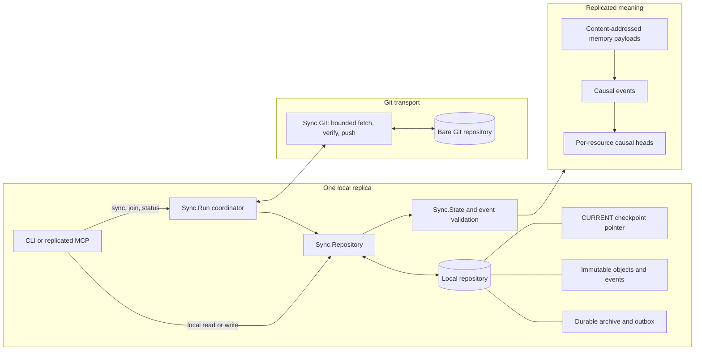
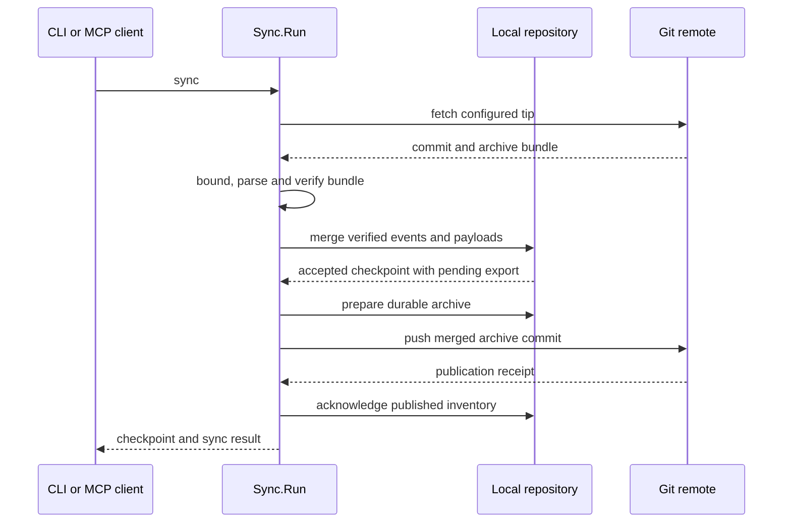

# Replica sync architecture

This document describes the experimental replica store (`akyuu replica` and
`akyuu mcp --tool-set replica`). It describes the current prototype, not a
production migration or a background sync service. The protocol is still
experimental. All replicas must use compatible repository formats.

## System view

The local repository is authoritative for that replica's accepted state.
Git carries immutable event and memory objects. A fetched bundle is checked
before import. Sync merges its event set with local history; it does not pick
a winner by timestamp. Concurrent heads remain visible until a user resolves
them.

## Data and causal model

Each event has a store ID, replica ID, nonce, parent event IDs, an action and
a timestamp. Its ID hashes its canonical bytes. Events contain no memory
body. Actions refer to content-addressed memory IDs, and the repository checks
that required payloads exist before it accepts a checkpoint.

The event graph records changes to topics, logs, pins, reviews and replica
registration. A resource's head is an event that no accepted later event for
that resource consumes. Topic conflicts retain all heads. Log reads follow
all predecessor branches. Concurrent pin or review changes also remain
visible. Timestamps do not order or discard concurrent events.

Local writes use an opaque resource version. The version includes the store
identity and current event heads. A write checks that version and the full
parent set. If another writer changes the same resource first, the old token
fails and the caller must read the new state. Remote imports can add unseen
concurrent events without a local version token.

## Checkpoints and durable publication

`CURRENT` names one immutable checkpoint manifest. The manifest records the
accepted event and payload inventories, pending export obligations, and
object residency. Readers capture one checkpoint and read only the objects
that it names. They do not infer accepted state from directory contents.

A local transaction validates its inputs, writes missing immutable objects
and events, writes the new manifest, and replaces `CURRENT` last. File and
directory flushes protect this order. A crash before pointer replacement
leaves the old state current. A failure after replacement can have an
uncertain result, so the caller must read current state before retry.

Pending events and payloads form a durable outbox. Archive preparation copies
accepted data into durable archive paths before it publishes archive
manifests. A publication receipt lets the local repository acknowledge an
export. Collection retains every causal branch, pending export, pin and
retaining memory edge. It archives required data before it evicts inactive
local copies. The archive can restore an evicted payload if later state needs
it.

## Sync and join flow

`Sync.Run` coordinates transport and repository state. It fetches the
configured Git tip, reads the bundle with output and storage bounds, and
validates the tree, hashes, canonical events, event closure and payload links.
It merges verified remote events against the latest local checkpoint. The
result remains pending until the remote publication is confirmed.

Before push, the runner prepares the immutable archive needed for export. It
pushes a Git commit and records the verified receipt. If the response is lost,
the next sync checks the remote tip and accepted inventories before it retries
or acknowledges publication. A rewritten remote tip is an explicit error.
Manual sync is initiated by a command; there is no background sync loop.

A fresh join downloads and verifies the remote bundle, creates a separate
local repository, imports the complete state, and registers the new replica.
The registration step can resume after interruption. Legacy migration is a
separate explicit snapshot-copy operation. It does not cut over a live store.

## Locking and validation

The repository uses a short mutation lock to serialize checkpoint
publication. It loads the current snapshot before acquiring that lock. Under
the lock, it checks that `IDENTITY` and `CURRENT` still match the captured
snapshot. If either changed, it releases the lock and loads again, with
at most three preflight snapshots. Resource and policy versions are checked
under the lock before publication.

A snapshot load reads the manifest and accepted events, checks their hashes
and canonical bytes, and validates the causal event graph. Accepted events are
also cached in `events.pack`, where each record is accepted only if its hash is
an ID that the manifest names. Payloads are checked when they enter a
transaction and when they are read. `replica verify` and `replica gc` check
every event file, every payload and their links across the full inventory.

Reads use the open file's size as an allocation hint. The hint does not limit
the read: reads continue in chunks until EOF or the configured byte cap.
Growth cannot bypass the cap, and truncated files stop at EOF. Hash and
canonical-format checks still run on the bytes read.

## Scope and validation status

The implementation has extensive unit, crash-boundary, CLI, MCP, HTTP, sync,
join, GC and migration checks. Those checks do not establish live-store
compatibility, coordinated migration, HTTPS authentication, packet-loss
recovery or Linux performance. The replica store remains experimental and opt-in
alongside the v1 store.

For exact format rules and test history, see [Sync v1 implementation
status](plans/sync-v1.md) and the dated experiments in
[`bench/results/`](../bench/results/).
